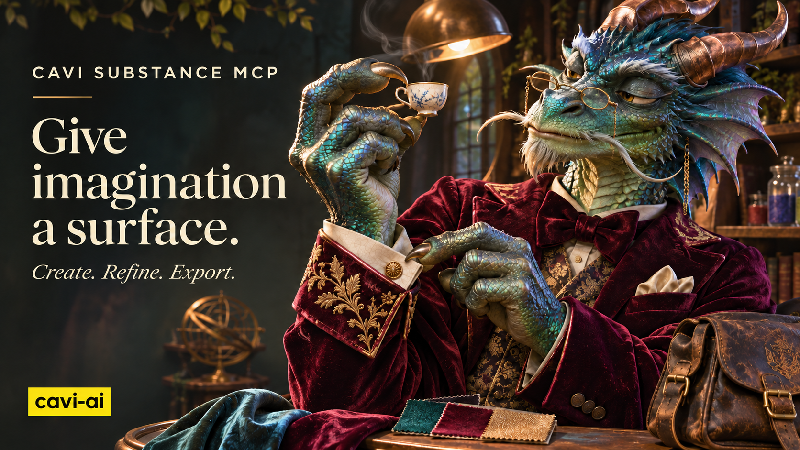
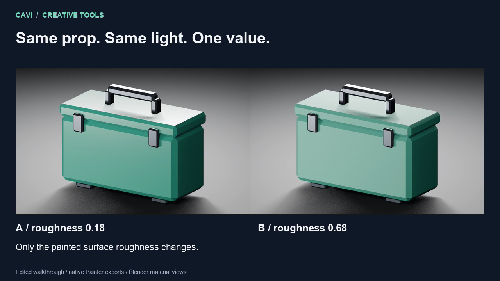

# Cavi Substance MCP

## Give imagination a surface.



[](https://pypi.org/project/cavi-substance-mcp/)

Work with an assistant across Adobe Substance 3D Painter, Designer and Sampler. Cavi Substance MCP connects your MCP client to each application through its own local server, with a shared asset workspace for moving work between them.

Ask for the result you want:

- “Make a working copy of this Painter project, adjust the finish and export its texture maps.”
- “Create an editable Designer material graph, then cook and render it.”
- “Open a copy of this Sampler project, adjust its layers and export maps for my target.”

Keep working in the native projects and inspect the results at each step. The applications support different operations; see the application support and tool documentation below for their boundaries.

## Application support

The Painter server supports project operations (UDIM, templates, mesh reload),
layer-tree inspection, paint, fill with UV, triplanar and planar projection,
group, mask, generator, smart-material,
smart-mask and `.sbsar` layers, mesh-map baking, shelf search and channel-packed
texture export. Native macOS brush input adds real 2D strokes with viewport
previews and pressure; see [Painter tools](docs/substance-mcp/source/pages/painter/tools.md#native-brush-painting).

The Designer server authors editable node graphs through the native SDK and drives
Designer’s headless CLIs for cooking, rendering, baking and packing. The Sampler server launches Sampler for one script per call or one batch job.
See the [overview](docs/substance-mcp/source/pages/introduction/overview.md) for the application workflows and setup.

## Install

Requires Python 3.15+, [uv](https://docs.astral.sh/uv/), and a separately installed and
licensed Adobe application.

Install the three servers as commands on your `PATH`: `cavi-substance-mcp` (Painter),
`cavi-substance-designer-mcp` and `cavi-substance-sampler-mcp`. The same install provides
`cavi-substance-receipts`, which verifies the manifests they write (see
[Receipts](docs/substance-mcp/source/pages/guides/receipts.md)).

```sh
uv tool install cavi-substance-mcp
```

Upgrade with `uv tool upgrade cavi-substance-mcp`. To work from a checkout instead, see
[CONTRIBUTING.md](CONTRIBUTING.md).

Register the servers you need in your MCP client. Desktop apps that do not inherit your
shell's `PATH` need absolute paths, which `command -v cavi-substance-mcp` prints.

```json
{
  "mcpServers": {
    "substance-painter": {"command": "cavi-substance-mcp"},
    "substance-designer": {"command": "cavi-substance-designer-mcp"},
    "substance-sampler": {"command": "cavi-substance-sampler-mcp"}
  }
}
```

Tools read and write files only inside the workspace. To use a folder other than the
default, add `"env": {"CAVI_SUBSTANCE_WORKSPACE": "/absolute/path"}` to a server entry.

### Painter

Launch the installed Painter application with remote scripting enabled:

```sh
cavi-substance-mcp runtime start
cavi-substance-mcp runtime status
```

Automatic launch supports macOS and requests a hidden, background start. If Painter is already open without a reachable scripting connection, save and quit it before launching again.

Ask your assistant to confirm that Painter is connected and wait until the project is ready before editing.

## See a material revision

[](examples/painter/uniform-fill-revision/README.md)

[Explore the editable Painter example](examples/painter/uniform-fill-revision/README.md), including the mesh, maps and steps to recreate it locally. The views are Blender renders of Painter exports.

## Documentation

The documentation is published for each release at
[cavi-ai.xyz/docs/substance-mcp](https://cavi-ai.xyz/docs/substance-mcp). Its source is in
`docs/substance-mcp/source`:

- [Installation](docs/substance-mcp/source/pages/introduction/installation.md) and
  [Quickstart](docs/substance-mcp/source/pages/introduction/quickstart.md)
- Painter: [tools](docs/substance-mcp/source/pages/painter/tools.md) and
  [shared application ownership](docs/substance-mcp/source/pages/painter/session-ownership.md)
- Designer: [tools](docs/substance-mcp/source/pages/designer/tools.md)
- Sampler: [tools](docs/substance-mcp/source/pages/sampler/tools.md),
  [batch jobs](docs/substance-mcp/source/pages/sampler/batch-jobs.md) and
  [source projects and authoring](docs/substance-mcp/source/pages/sampler/source-projects.md)
- [Receipts](docs/substance-mcp/source/pages/guides/receipts.md) and
  [channel packing](docs/substance-mcp/source/pages/guides/packing.md)
- [Configuration](docs/substance-mcp/source/pages/reference/configuration.md),
  [testing and evaluation](docs/substance-mcp/source/pages/reference/testing.md) and the
  [security model](docs/substance-mcp/source/pages/security/model.md)

## Contributing

See [CONTRIBUTING.md](CONTRIBUTING.md) for setup, checks and the rules for changes.

## Security

Report vulnerabilities privately as described in [SECURITY.md](SECURITY.md).

## License

MIT. See [LICENSE](LICENSE).

## Trademarks

Adobe, Substance 3D, Substance 3D Painter, Substance 3D Designer and Substance 3D Sampler are
either registered trademarks or trademarks of Adobe in the United States and/or other
countries. This project is not affiliated with, endorsed by, or sponsored by Adobe. It does
not include or redistribute Adobe software, templates, presets or Substance files; you supply
your own licensed applications. Other product names (for example Unreal Engine, Unity and
Blender) belong to their respective owners.

