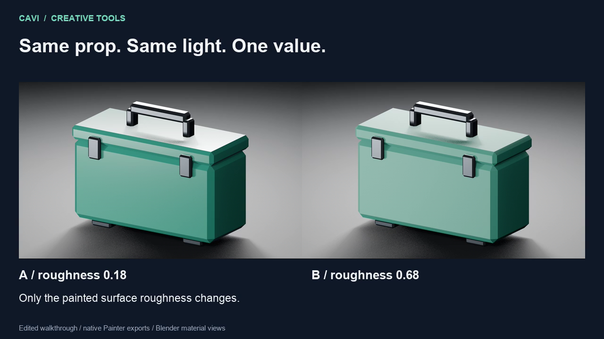

# Cavi Substance MCP

MCP servers for Adobe Substance 3D Painter, Adobe Substance 3D Designer and Adobe
Substance 3D Sampler. Each application has its own stdio server.

## Try one material revision

Change a utility case's painted roughness from 0.18 to 0.68, inspect the exported
PNG16 maps, and reopen the saved project copy. The example includes the original
mesh, maps and steps to recreate an editable Painter project locally.

[](examples/painter/uniform-fill-revision/utility-case-roughness-walkthrough.mp4)

[Watch the 36-second edited walkthrough](examples/painter/uniform-fill-revision/utility-case-roughness-walkthrough.mp4)
or [reproduce the uniform-fill example](examples/painter/uniform-fill-revision/README.md).
The material views are Blender renders of actual Painter exports.

## Application support

The Painter server supports project operations (UDIM, templates, mesh reload),
layer-tree inspection, paint, fill, group, mask, generator, smart-material,
smart-mask and `.sbsar` layers, mesh-map baking, shelf search and channel-packed
texture export. Native macOS brush input adds real 2D strokes with viewport
previews and pressure; see [Painter tools](docs/substance-mcp/source/pages/painter/tools.md#native-brush-painting).

The Designer server authors editable node graphs through the native SDK and drives
Designer’s headless CLIs for cooking, rendering, baking and packing. The Sampler server launches Sampler for one script per call or one batch job.
The [overview](docs/substance-mcp/source/pages/introduction/overview.md) lists what has been
checked natively and what has been tested only against a simulator.

## Install

Requires Python 3.15+, [uv](https://docs.astral.sh/uv/), and a separately installed and
licensed Adobe application. The MCP does not supply an Adobe license or authenticate
accounts.

Install the three servers as commands on your `PATH`: `cavi-substance-mcp` (Painter),
`cavi-substance-designer-mcp` and `cavi-substance-sampler-mcp`. The same install provides
`cavi-substance-receipts`, which verifies the manifests they write (see
[Receipts](docs/substance-mcp/source/pages/guides/receipts.md)).

```sh
uv tool install cavi-substance-mcp
```

Upgrade with `uv tool upgrade cavi-substance-mcp`. To work from a checkout instead, see
[CONTRIBUTING.md](CONTRIBUTING.md).

Register the servers you need in your MCP client. Desktop apps that do not inherit your
shell's `PATH` need absolute paths, which `command -v cavi-substance-mcp` prints.

```json
{
  "mcpServers": {
    "substance-painter": {"command": "cavi-substance-mcp"},
    "substance-designer": {"command": "cavi-substance-designer-mcp"},
    "substance-sampler": {"command": "cavi-substance-sampler-mcp"}
  }
}
```

Tools read and write files only inside the workspace. To use a folder other than the
default, add `"env": {"CAVI_SUBSTANCE_WORKSPACE": "/absolute/path"}` to a server entry.

### Painter

Launch the installed Painter application with remote scripting enabled:

```sh
cavi-substance-mcp runtime start
cavi-substance-mcp runtime status
```

Automatic launch currently supports macOS. It finds the standard Adobe installation,
or the app bundle selected by `CAVI_PAINTER_APP`, and supplies `--enable-remote-scripting`.
Painter starts hidden without bringing it to the foreground.
A connected session is reused. An open app without a reachable scripting connection
is left untouched; save and quit that app before launching it again. The launcher does
not install software, sign in, accept terms, or dismiss license prompts.

`start` reports that launch was requested; it does not claim Painter is ready. Require
`connected=true` from `status` or the actual `painter_status` MCP tool before project work.

Call `painter_status` first. After `open`/`create`/`reload_mesh`, call `project` with `action="wait_ready"` before editing.

## Documentation

The documentation is published for each release at
[cavi-ai.xyz/docs/substance-mcp](https://cavi-ai.xyz/docs/substance-mcp). Its source is in
`docs/substance-mcp/source`:

- [Installation](docs/substance-mcp/source/pages/introduction/installation.md) and
  [Quickstart](docs/substance-mcp/source/pages/introduction/quickstart.md)
- Painter: [tools](docs/substance-mcp/source/pages/painter/tools.md) and
  [shared application ownership](docs/substance-mcp/source/pages/painter/session-ownership.md)
- Designer: [tools](docs/substance-mcp/source/pages/designer/tools.md)
- Sampler: [tools](docs/substance-mcp/source/pages/sampler/tools.md),
  [batch jobs](docs/substance-mcp/source/pages/sampler/batch-jobs.md) and
  [source projects and authoring](docs/substance-mcp/source/pages/sampler/source-projects.md)
- [Receipts](docs/substance-mcp/source/pages/guides/receipts.md) and
  [channel packing](docs/substance-mcp/source/pages/guides/packing.md)
- [Configuration](docs/substance-mcp/source/pages/reference/configuration.md),
  [testing and evaluation](docs/substance-mcp/source/pages/reference/testing.md) and the
  [security model](docs/substance-mcp/source/pages/security/model.md)

## Contributing

See [CONTRIBUTING.md](CONTRIBUTING.md) for setup, checks and the rules for changes.

## Security

Report vulnerabilities privately as described in [SECURITY.md](SECURITY.md).

## License

MIT. See [LICENSE](LICENSE).

## Trademarks

Adobe, Substance 3D, Substance 3D Painter, Substance 3D Designer and Substance 3D Sampler are
either registered trademarks or trademarks of Adobe in the United States and/or other
countries. This project is not affiliated with, endorsed by, or sponsored by Adobe. It does
not include or redistribute Adobe software, templates, presets or Substance files; you supply
your own licensed applications. Other product names (for example Unreal Engine, Unity and
Blender) belong to their respective owners.

## Response contracts and recovery

The catalog declares fields for key status, ownership and export results. Existing
additional details remain available. Discovery omits redundant schema titles while
retaining validation constraints and field names.

Anticipated MCP failures retain readable text and include code, operation, outcome,
retry_safe and next_action. Unknown outcomes require application and output
inspection; these hints never automatically retry a mutation. Unexpected defects
remain opaque to callers.
