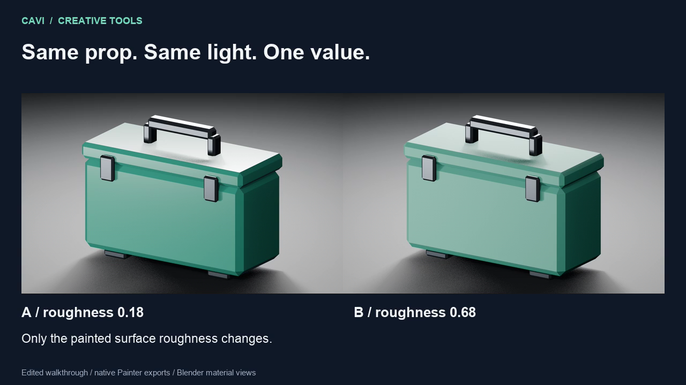

# Revise one uniform fill

One original utility-case mesh, two texture sets, and one material choice:
roughness **0.18 or 0.68**. Recreate the editable project in your own Painter
workspace, export the maps, then reopen the saved copy and check the result.

This example was run with Cavi Substance MCP 0.12.0 and Painter 12.2.0 on macOS.
Its material views use the actual exported maps in Blender 5.2.3 LTS with
Blender MCP 0.44.0. They are Blender renders, not a Painter viewport recording.

[](utility-case-roughness-walkthrough.mp4)

[Watch the 36-second edited walkthrough](utility-case-roughness-walkthrough.mp4).

## Files and result

- `utility_case.obj` and `utility_case.mtl`: original, editable geometry with
  `PaintedMetal` and `Hardware` material assignments.
- `create_utility_case.py`: a standard-library-only mesh generator. Run it in a
  copy of this example to regenerate the OBJ and MTL.
- `material-settings.json`: the A-state fill values and export settings.
- `maps-A/`: the two sets' original base-color, roughness and metalness maps.
- `maps-B/PaintedMetal_Specular_roughness.png`: the changed B-state map. The
  other maps are unchanged.
- `results.json`: file hashes and the observed scalar/export comparisons.

| Check | Observed result |
| --- | --- |
| A painted roughness | 11796/65535, approximately 0.179995 |
| B painted roughness | 44564/65535, approximately 0.680003 |
| Hardware roughness / metalness | Approximately 0.349996 / 0.850004 |
| Painted metalness | Approximately 0.149996 in both states |
| A versus B | Only the painted roughness map changed among the 12 exported PNGs |
| Saved B project reopened and exported again | All 12 PNG files were byte-identical |

The maps are 1024×1024 PNG16. The tested roughness and metalness samples match
their inputs within 2/65535. These scalar checks do not establish full base-color
fidelity. Uniform fills demonstrate parameter changes, not procedural wear or
geometry changes. The values are example choices, not physical reference values.

## Recreate it

Use a separately installed, licensed Painter and the existing
[installation instructions](../../../README.md#install). Copy this example into
your configured MCP workspace. Create an `outputs` parent folder; use a new
destination for each export and saved copy.

1. Call `painter_status` and inspect `session_control`. Use an idle, owned
   session with no other project to preserve. Claim its current `project_id`.
   Follow the [ownership guide](../../../docs/substance-mcp/source/pages/painter/session-ownership.md)
   if the project identity changes after loading.
2. Call `project` with these arguments, replacing the lease placeholder:

   ```json
   {
     "action": "create",
     "mesh_path": "utility_case.obj",
     "normal_map_format": "OpenGL",
     "default_texture_resolution": 1024,
     "source_precision": "16",
     "lease_id": "<your-lease>"
   }
   ```

   Call `project` with `action="wait_ready"` before editing. Inspect the texture
   sets; this OBJ produces `Hardware` and `PaintedMetal`.
3. Add the A fill through `layer_edit`:

   ```json
   {
     "action": "fill",
     "texture_set": "PaintedMetal",
     "name": "Paint A roughness 0.18",
     "base_color": [0.12, 0.42, 0.35],
     "roughness": 0.18,
     "metallic": 0.15,
     "lease_id": "<your-lease>"
   }
   ```

   Add the `Hardware` fill using its values in `material-settings.json`.
   Inspect the layer stack and retain the returned layer IDs.
4. Inspect `export_presets`. The run used
   `export-preset-generator://doc-channel-normal-no-alpha` with PNG and 16-bit
   output. Preview `export_textures` with `dry_run=true`, then write to a new
   directory with `dry_run=false`. Require `status="Success"` and inspect
   `omitted_files`; the preset's mixed-AO outputs were omitted in this example.
5. Add a second `PaintedMetal` uniform fill above A, using the same base color
   and metalness with roughness **0.68**. Use A's returned integer `uid` as
   `above_uid`. Inspect the stack to confirm B is above A, then export to a
   different directory. Compare the actual files: only the painted roughness
   PNG should differ for these inputs.
6. Save B with `project action="save_copy"` to a new directory. Retain the
   returned project path and verify the copy exists before closing your owned
   working project. The close guard requires the current `expected_file`; an
   unsaved working copy also requires explicit `discard_unsaved=true` after
   its saved copy has been checked. Preserve every other project.
7. Open that returned saved-copy path, wait until ready, and inspect B's fill
   values. Export again to another new directory and compare its PNG bytes
   with B. The supplied run retained B's roughness and all 12 exported files.

If an operation reports an unknown outcome, inspect the application and output
files before another write. Do not replay an uncertain mutation automatically.

## View the exported material

Import the original OBJ into an owned Blender scene using
[Cavi Blender MCP](https://github.com/cavi-ai/blender-mcp). Bind each material's
actual exported maps: base color as sRGB, roughness and metalness as Non-Color.
Keep camera, lights and framing unchanged when comparing A and B. Inspect the
material bindings before rendering.

The original geometry and example files use this repository's MIT license.
The editable Painter project is recreated locally; no Adobe application,
template, preset or Substance project file is included.
